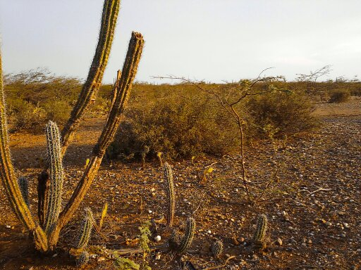
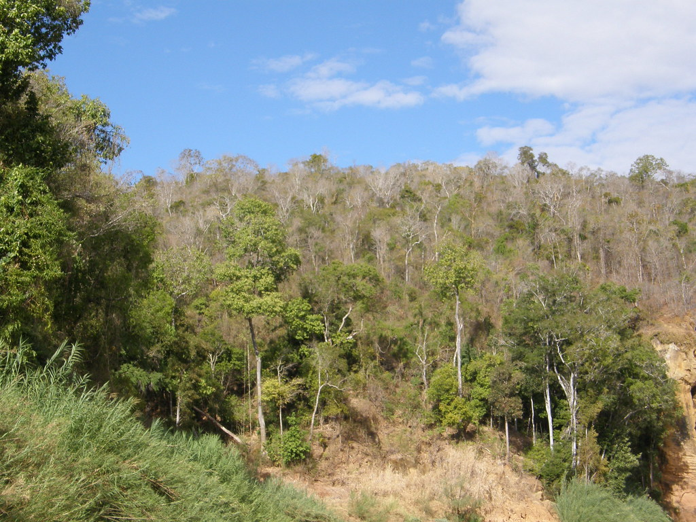
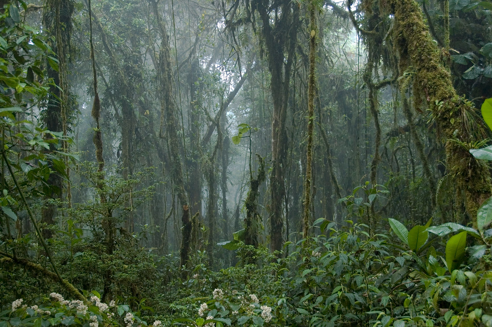
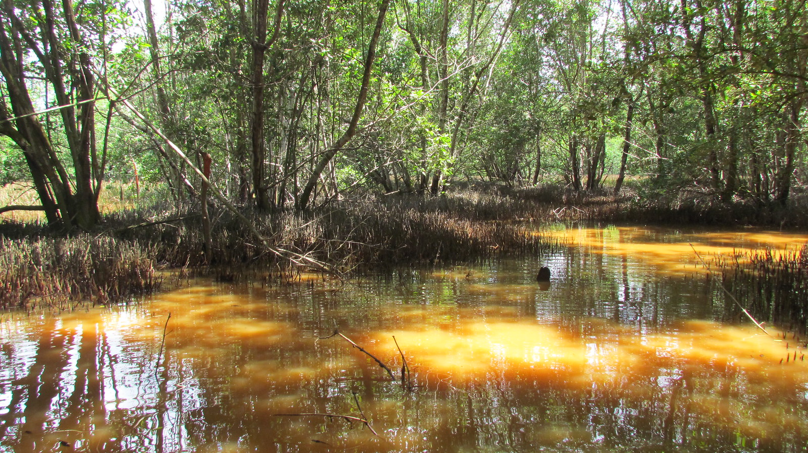
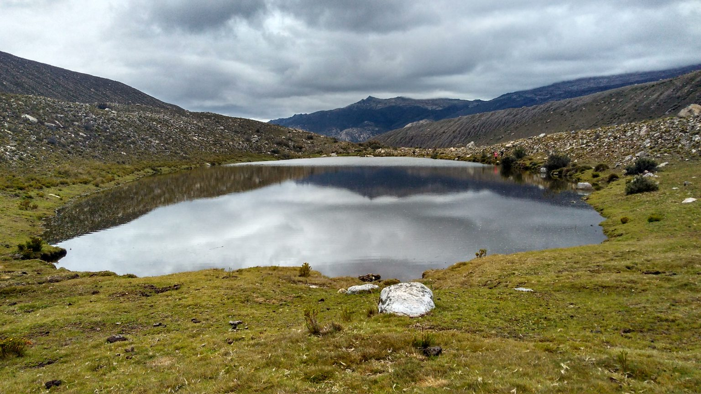

```{r setup}
library(ggplot2)
library(dplyr)
library(tidyr)
library(leaflet)

# Paleta institucional y bioclimática
paleta_biomas <- c(
  "md-T / me-T (Árido)" = "#D97706",
  "bs-T (Seco Tropical)" = "#65A30D",
  "bh-T / bmh-T (Húmedo)" = "#0D9488",
  "Halobioma / Humedales" = "#0284C7",
  "Pisos Montanos (SNSM/Perijá)" = "#6366F1"
)
```

## Objetivos de Aprendizaje

1.  **Comprender** los forzantes océano-atmosféricos (Alisios del NE, surgencias y barreras orográficas) que configuran el mosaico climático del Caribe colombiano.
2.  **Clasificar** las principales Zonas de Vida de Holdridge desde el litoral árido de La Guajira hasta el piso nival de la Sierra Nevada de Santa Marta.
3.  **Caracterizar** la estructura de la vegetación, las adaptaciones ecofisiológicas y la fauna diagnóstica de cada zona de vida.
4.  **Analizar** el estado de transformación y las trayectorias de restauración ecológica del bosque seco tropical (`bs-T`).

## Mapa Geoclimático: Litoral Norte, Surgencias y Sombra Orográfica

::::: columns
::: {.column width="62%"}
```{r fig-mapa-caribe}
#| fig-width: 7.4
#| fig-height: 5.2
#| out-width: "100%"
#| eval: true

#| out-width: "100%"

puntos_zv <- tibble(
  nombre = c("Alta Guajira (md-T)", "PNN Tayrona (bs-T)", "SNSM (5.775 m)",
             "Ciénaga Grande (Manglar)", "Serranía Perijá", "Montes de María (bs-T)",
             "Urabá (bh-T)"),
  detalle = c("Precipitación < 300 mm/año; matorral desértico tropical",
              "Bosque seco litoral y mosaico subxerofítico",
              "Gradiente completo hasta piso nival en < 45 km",
              "Complejo lagunar-estuarino y bosques de manglar",
              "Corredor andino-caribeño y barrera oriental",
              "Núcleo remanente de bosque seco tropical (bs-T)",
              "Transición hacia selva húmeda del Chocó biogeográfico"),
  lon = c(-71.85, -73.98, -73.67, -74.45, -72.92, -75.20, -76.68),
  lat = c(12.05, 11.31, 10.83, 10.82, 10.15, 9.55, 8.08),
  bioma = c("md-T / me-T (Árido)", "bs-T (Seco Tropical)", "Pisos Montanos (SNSM/Perijá)",
            "Halobioma / Humedales", "Pisos Montanos (SNSM/Perijá)", "bs-T (Seco Tropical)",
            "bh-T / bmh-T (Húmedo)"),
  color_hex = unname(paleta_biomas[bioma])
)

surgencias <- tibble(
  lon = c(-72.25, -73.45, -74.15),
  lat = c(12.25, 11.55, 11.22),
  radio = c(32000, 22000, 18000),
  etiqueta = c("<b>Surgencia Guajira</b><br>Afloramiento frío (TSM < 22 °C)",
               "<b>Surgencia Tayrona</b><br>Afloramiento estacional",
               "<b>Surgencia Magdalena</b><br>Borde oriental delta")
)

# Vectores de vientos Alisios del NE
vientos_df <- tibble(
  id = 1:4,
  lon1 = c(-71.1, -72.1, -73.0, -74.7),
  lat1 = c(12.8, 12.4, 11.9, 11.4),
  lon2 = c(-72.0, -73.0, -73.7, -75.4),
  lat2 = c(12.1, 11.7, 11.3, 10.6)
)

mapa <- leaflet(height = "500px") %>%
  # Capas base de elevación y topografía
  addProviderTiles(providers$Esri.WorldShadedRelief, group = "Relieve Sombreado (Esri)") %>%
  addProviderTiles(providers$OpenTopoMap, group = "Topográfico y Curvas (OpenTopo)") %>%
  addProviderTiles(providers$Esri.WorldImagery, group = "Imagen Satelital") %>%
  setView(lng = -74.0, lat = 10.4, zoom = 6) %>%
  # Focos de surgencia costera
  addCircles(
    data = surgencias, lng = ~lon, lat = ~lat, radius = ~radio,
    color = "#0284C7", fillColor = "#38BDF8", fillOpacity = 0.45, weight = 1.5,
    popup = ~etiqueta, group = "Surgencias y Vientos"
  ) %>%
  # Zona de sombra orográfica (Valle del Cesar)
  addRectangles(
    lng1 = -73.60, lat1 = 9.70, lng2 = -73.05, lat2 = 10.45,
    color = "#D97706", fillColor = "#F59E0B", fillOpacity = 0.25, weight = 1,
    popup = "<b>Sombra Orográfica (Valle del Cesar)</b><br>Bloqueo de humedad entre SNSM y Perijá",
    group = "Surgencias y Vientos"
  ) %>%
  # Puntos de zonas de vida
  addCircleMarkers(
    data = puntos_zv, lng = ~lon, lat = ~lat,
    radius = 8, color = "#FFFFFF", weight = 2,
    fillColor = ~color_hex, fillOpacity = 0.95,
    label = ~nombre,
    popup = ~paste0("<b>", nombre, "</b><br><i>", bioma, "</i><br>", detalle),
    group = "Zonas de Vida"
  )

# Añadir flechas de vientos Alisios
for (i in seq_len(nrow(vientos_df))) {
  mapa <- mapa %>%
    addPolylines(
      lng = c(vientos_df$lon1[i], vientos_df$lon2[i]),
      lat = c(vientos_df$lat1[i], vientos_df$lat2[i]),
      color = "#0369A1", weight = 3, opacity = 0.85,
      popup = "<b>Vientos Alisios del NE</b><br>Forzante de surgencia y transporte de humedad",
      group = "Surgencias y Vientos"
    )
}

mapa %>%
  addLegend(
    position = "bottomleft",
    colors = unname(paleta_biomas),
    labels = names(paleta_biomas),
    title = "Zonas de Vida",
    opacity = 0.9
  ) %>%
  addLayersControl(
    baseGroups = c("Relieve Sombreado (Esri)", "Topográfico y Curvas (OpenTopo)", "Imagen Satelital"),
    overlayGroups = c("Zonas de Vida", "Surgencias y Vientos"),
    options = layersControlOptions(collapsed = TRUE)
  )

```
:::

::: {.column width="38%"}
### Mecanismos Clave

- **Surgencia Costera (Upwelling):** Los vientos Alisios paralelos a la costa de La Guajira y Tayrona desplazan aguas superficiales (Transporte de Ekman), aflorando aguas frías ($<22\,^\circ\text{C}$) que inhiben la convección y generan aridez litoral.
- **Barrera Orográfica:** La **SNSM** ($5.775\text{ m}$) y la **Serranía del Perijá** interceptan la humedad de los Alisios en barlovento y proyectan una marcada **sombra pluviométrica** sobre el Valle del Cesar.
- **Gradiente SW–NE:** Transición desde selvas superhúmedas en Urabá ($>2.500\text{ mm/año}$) hasta matorrales desérticos en la Alta Guajira ($<300\text{ mm/año}$).
:::
:::::

## Clasificación Bioclimática de Holdridge en el Caribe

::::: columns
::: {.column width="58%"}
```{r fig-holdridge-caribe}
#| fig-width: 6.8
#| fig-height: 4.8
#| out-width: "100%"

holdridge_df <- tibble(
  zona = c("md-T\n(Matorral desértico)", "me-T\n(Monte espinoso)",
           "bs-T\n(Bosque seco)", "bh-T\n(Bosque húmedo)",
           "bmh-T\n(Bosque muy húmedo)", "bh-PM / bmh-PM\n(Premontano)",
           "bh-MB / bmh-MB\n(Montano Bajo)", "bp-M / pp-SA\n(Montano / Páramo)"),
  bt_min = c(24, 24, 24, 24, 24, 18, 12, 3),
  bt_max = c(29, 29, 29, 29, 29, 24, 18, 12),
  pp_min = c(125, 250, 500, 1000, 2000, 1000, 1000, 500),
  pp_max = c(250, 500, 1000, 2000, 4000, 4000, 4000, 2000),
  grupo = c("md-T / me-T (Árido)", "md-T / me-T (Árido)",
            "bs-T (Seco Tropical)", "bh-T / bmh-T (Húmedo)",
            "bh-T / bmh-T (Húmedo)", "Pisos Montanos (SNSM/Perijá)",
            "Pisos Montanos (SNSM/Perijá)", "Pisos Montanos (SNSM/Perijá)")
)

ggplot(holdridge_df) +
  geom_rect(aes(xmin = pp_min, xmax = pp_max, ymin = bt_min, ymax = bt_max, fill = grupo),
            alpha = 0.75, color = "white", linewidth = 0.8) +
  geom_text(aes(x = sqrt(pp_min * pp_max), y = (bt_min + bt_max) / 2, label = zona),
            size = 2.7, fontface = "bold", color = "#0F172A") +
  scale_x_continuous(trans = "log2", breaks = c(125, 250, 500, 1000, 2000, 4000),
                     labels = c("125", "250", "500", "1.000", "2.000", "4.000")) +
  scale_y_continuous(breaks = c(3, 6, 12, 18, 24, 29)) +
  scale_fill_manual(values = paleta_biomas) +
  labs(
    title = "Envolventes Bioclimáticas (Sistema Holdridge)",
    subtitle = "Biotemperatura media anual (°C) vs. Precipitación total anual (mm, escala log2)",
    x = "Precipitación Media Anual (mm)", y = "Biotemperatura (°C)"
  ) +
  theme_minimal(base_size = 11) +
  theme(legend.position = "none", plot.title = element_text(face = "bold"))
```
:::

::: {.column width="42%"}
### Estructura del Sistema

- **Piso Basal Tropical (**$>24\,^\circ\text{C}$): Domina las llanuras del Caribe; la diferenciación ecológica depende casi exclusivamente de la relación evapotranspiración potencial / precipitación ($ETP/P$).
- **Escalonamiento Altitudinal:** En la SNSM y el Perijá, el gradiente adiabático ($\approx -0.6\,^\circ\text{C}/100\text{ m}$) comprime cinco pisos térmicos en menos de $45\text{ km}$ lineales.
- **Azonalidad Edáfica:** Manglares y ciénagas operan bajo control hídrico-salino independientemente de la isoyeta local.
:::
:::::

## Regímenes Pluviométricos Comparados

::::: columns
::: {.column width="60%"}
```{r fig-climograma}
#| fig-width: 7
#| fig-height: 4.6
#| out-width: "100%"

meses <- factor(c("Ene", "Feb", "Mar", "Abr", "May", "Jun",
                  "Jul", "Ago", "Sep", "Oct", "Nov", "Dic"),
                levels = c("Ene", "Feb", "Mar", "Abr", "May", "Jun",
                           "Jul", "Ago", "Sep", "Oct", "Nov", "Dic"))

clima_df <- tibble(
  Mes = rep(meses, 3),
  Zona = rep(c("Alta Guajira (md-T, ~260 mm)",
               "Caribe Central / Cesar (bs-T, ~980 mm)",
               "Urabá / Darién (bh-T, ~2.650 mm)"), each = 12),
  Precipitacion = c(
    5, 2, 3, 12, 28, 10, 5, 15, 45, 75, 45, 15,
    12, 15, 25, 75, 135, 85, 65, 95, 145, 185, 110, 33,
    95, 75, 85, 190, 290, 275, 250, 280, 310, 330, 285, 185
  )
)

ggplot(clima_df, aes(x = Mes, y = Precipitacion, color = Zona, group = Zona)) +
  geom_hline(yintercept = 100, linetype = "dashed", color = "#DC2626", linewidth = 0.7) +
  annotate("text", x = "Mar", y = 112, label = "Umbral déficit hídrico (< 100 mm/mes)",
           color = "#DC2626", size = 3, hjust = 0, fontface = "italic") +
  geom_line(linewidth = 1.2) +
  geom_point(size = 2.5) +
  scale_color_manual(values = c("#D97706", "#65A30D", "#0D9488")) +
  labs(
    title = "Estacionalidad y Déficit Hídrico en el Caribe",
    subtitle = "Distribución mensual de la precipitación (mm) en tres zonas de vida contrastantes",
    x = NULL, y = "Precipitación (mm)", color = NULL
  ) +
  theme_minimal(base_size = 11) +
  theme(legend.position = "bottom", plot.title = element_text(face = "bold"))
```
:::

::: {.column width="40%"}
### Dinámica Estacional

- **Veranillo de San Juan (Jun–Ago):** Intensificación transitoria de los Alisios que divide la época húmeda en un régimen **bimodal** típico del `bs-T`.
- **Época Seca Mayor (Dic–Abr):** Entre 4 y 6 meses con precipitación $<100\text{ mm/mes}$, forzando la **caducifolia** del $70\text{--}85\%$ del dosel arbóreo.
- **Alta Guajira:** Las lluvias se concentran casi exclusivamente entre septiembre y noviembre por ondas tropicales y paso de ciclones.
:::
:::::

## Zonas de Vida Ecológicas del Caribe Colombiano (Sistema de Holdridge)

| Zona de Vida | Sigla | Precipitación Anual ($\text{mm/año}$) | Biotemperatura Media ($^\circ\text{C}$) | Piso Altitudinal / Rango ($\text{m s. n. m.}$) |
|:-----------|:----------:|:----------:|:----------:|:----------:|
| **Maleza desértica Tropical** | `md-T` | $125 - 250$ | $> 24$ | Basal ($0 - 300$) |
| **Monte espinoso Tropical** | `me-T` | $250 - 500$ | $> 24$ | Basal ($0 - 500$) |
| **Bosque muy seco Tropical** | `bms-T` | $500 - 1.000$ | $> 24$ | Basal ($0 - 600$) |
| **Bosque seco Tropical** | `bs-T` | $1.000 - 2.000$ | $> 24$ | Basal ($0 - 1.000$) |
| **Bosque húmedo Tropical** | `bh-T` | $2.000 - 4.000$ | $> 24$ | Basal ($0 - 1.000$) |
| **Bosque muy húmedo Tropical** | `bmh-T` | $4.000 - 8.000$ | $> 24$ | Basal ($0 - 1.000$) |
| **Bosque húmedo Premontano** | `bh-PM` | $1.000 - 2.000$ | $18 - 24$ | Premontano ($1.000 - 2.000$) |
| **Bosque muy húmedo Premontano** | `bmh-PM` | $2.000 - 4.000$ | $18 - 24$ | Premontano ($1.000 - 2.000$) |
| **Bosque pluvial Premontano** | `bp-PM` | $> 4.000$ | $18 - 24$ | Premontano ($1.000 - 2.000$) |
| **Bosque húmedo Montano Bajo** | `bh-MB` | $1.000 - 2.000$ | $12 - 18$ | Montano Bajo ($2.000 - 3.000$) |
| **Bosque muy húmedo Montano Bajo** | `bmh-MB` | $2.000 - 4.000$ | $12 - 18$ | Montano Bajo ($2.000 - 3.000$) |
| **Bosque pluvial Montano Bajo** | `bp-MB` | $> 4.000$ | $12 - 18$ | Montano Bajo ($2.000 - 3.000$) |
| **Bosque muy húmedo Montano / Pluvial Montano** | `bmh-M` / `bp-M` | $1.000 - >2.000$ | $6 - 12$ | Montano ($3.000 - 3.800$) |
| **Páramo Subalpino / Pluvial Subalpino** | `p-SA` / `pp-SA` | $500 - >1.000$ | $3 - 6$ | Subalpino ($3.800 - 4.700$) |
| **Tundra Pluvial Alpina y Piso Nival** | `tp-A` / `N` | Variable (nieve/granizo) | $< 3$ | Alpino y Nival ($> 4.700$) |


## Distribución Geográfica de las Zonas de Vida Ecológicas del Caribe Colombiano  {.scrollable}

| Zona de Vida | Sigla | Distribución Geográfica en el Caribe Colombiano |
|:------------|:-----------:|:------------|
| **Maleza desértica Tropical** | `md-T` | Alta Guajira (Cabo de la Vela, Punta Gallinas, Nazareth, Puerto Estrella) y franja hiperárida litoral del noreste. |
| **Monte espinoso Tropical** | `me-T` | Media y Baja Guajira (Uribia, Manaure, Riohacha), litoral seco de Santa Marta (Taganga, Pozos Colorados) y enclaves xerofíticos de Galerazamba y Bocachica (Bolívar). |
| **Bosque muy seco Tropical** | `bms-T` | Cinturón costero entre Barranquilla y Cartagena, norte del Atlántico, cuenca baja del río Ranchería, piedemonte árido norte y oeste de la SNSM y enclave del Valle del Cesar (Codazzi–Valledupar). |
| **Bosque seco Tropical** | `bs-T` | Matriz histórica principal de la llanura del Caribe: centro y sur de Atlántico, Bolívar, Sucre, Córdoba (valle medio del Sinú), Magdalena, Cesar, Montes de María y sector bajo del PNN Tayrona. |
| **Bosque húmedo Tropical** | `bh-T` | Urabá antioqueño y chocoano, alto Sinú y San Jorge (Nudo de Paramillo), depresión Momposina sur, sur del Cesar, piedemonte húmedo norte/occidental de la SNSM (Buritaca–Don Diego) y cuenca del Catatumbo norte. |
| **Bosque muy húmedo Tropical** | `bmh-T` | Piedemonte norte del Nudo de Paramillo (tierras altas de Córdoba y Urabá sur) y sectores de máxima condensación orográfica en la vertiente norte de la Sierra Nevada de Santa Marta (cuencas medias-bajas de los ríos Palomino y Ancho). |
| **Bosque húmedo Premontano** | `bh-PM` | Vertientes medias secas a subhúmedas de la Sierra Nevada de Santa Marta (cuencas de los ríos Guatapurí, Cesar y Aracataca) y flanco occidental de la Serranía del Perijá (Manaure, Becerril, La Jagua). |
| **Bosque muy húmedo Premontano** | `bmh-PM` | Vertiente norte y noroccidental de la Sierra Nevada de Santa Marta (San Lorenzo, Minca alta, cuenca del río Córdoba) y estribaciones septentrionales del Nudo de Paramillo. |
| **Bosque pluvial Premontano** | `bp-PM` | Franja hiperhúmeda de condensación persistente en la vertiente norte de la Sierra Nevada de Santa Marta (entre $1.100$ y $1.900\text{ m}$). |
| **Bosque húmedo Montano Bajo** | `bh-MB` | Vertiente suroriental (sombra de lluvia) de la Sierra Nevada de Santa Marta y sectores medios-altos de la Serranía del Perijá. |
| **Bosque muy húmedo Montano Bajo** | `bmh-MB` | Selva nublada andina de la Sierra Nevada de Santa Marta (cuchilla de San Lorenzo, alto Buritaca y Palomino) y partes altas húmedas de la Serranía del Perijá (Cerro Pintao). |
| **Bosque pluvial Montano Bajo** | `bp-MB` | Vertiente norte expuesta a los vientos Alisios en la Sierra Nevada de Santa Marta, con nubosidad permanente y alta epifitia. |
| **Bosque muy húmedo Montano / Pluvial Montano** | `bmh-M` / `bp-M` | Bosque altoandino enano y subpáramo de la Sierra Nevada de Santa Marta y cumbres más elevadas de la Serranía del Perijá (sector Sabana Rubia – Cerro Pintao). |
| **Páramo Subalpino / Pluvial Subalpino** | `p-SA` / `pp-SA` | Páramo azonal de la Sierra Nevada de Santa Marta (dominado por pajonales, frailejones endémicos como *Libanothamnus* y lagunas glaciares). |
| **Tundra Pluvial Alpina y Piso Nival** | `tp-A` / `N` | Cumbres glaciares y periglaciares de la Sierra Nevada de Santa Marta (picos Simón Bolívar y Cristóbal Colón, hasta $5.775\text{ m}$). |

: {tbl-colwidths="[10,10,80]"}

## Matorral Desértico (`md-T`) y Monte Espinoso (`me-T`)

::::: columns
::: {.column width="52%"}
### Estructura de la Vegetación

- **Fisonomía abierta y baja:** Cobertura discontinua ($20\text{--}60\%$) dominada por arbustos achaparrados ($1.5\text{--}4\text{ m}$), cactáceas columnares emergentes ($5\text{--}8\text{ m}$) y suelo desnudo con costras biológicas.
- **Estratificación simple:** Ausencia de dosel continuo; microhábitats concentrados bajo "islas de fertilidad" alrededor de leguminosas nodrizas.

### Adaptaciones Ecofisiológicas

- **Metabolismo CAM y suculencia:** Cactáceas (*Stenocereus griseus*, *Subpilocereus repandus*, *Melocactus curvispinus*) con apertura estomática nocturna y tejidos almacenadores de agua.
- **Xeromorfismo extremo:** Microfilia, folíolos plegables para reducir radiación incidente, espinas estipulares y cutículas cerosas gruesas (*Prosopis juliflora*, *Libidibia coriaria*, *Vachellia tortuosa*).
- **Freatofitismo:** Raíces pivotantes profundas ($>15\text{ m}$) en *Prosopis* para acceder a acuíferos salobres subsuperficiales.
:::

::: {.column width="48%"}
{height="240px"}

### Fauna Asociada y Estrategias

- **Termorregulación y hábitos fosoriales/nocturnos:** Reptiles heliotermos (*Cnemidophorus lemniscatus*, *Iguana iguana*) y roedores heterómidos.
- **Polinización y dispersión por quiropterofilia/ornitofilia:** Murciélagos nectarívoros (*Glossophaga longirostris*, *Leptonycteris curasoae*) sincronizados con la floración nocturna de cardones.
- **Endemismos áridos:** *Cardinalis phoeniceus* (cardenal guajiro) y *Leucippus fallax* (colibrí anteado).
:::
:::::

## Bosque Seco Tropical (`bs-T`)

::::: columns
::: {.column width="52%"}
### Estructura de la Vegetación

- **Dosel semiabierto estacional (**$15\text{--}25\text{ m}$): Emergentes dispersos como *Cavanillesia platanifolia* (macondo) y *Ceiba pentandra*; estrato medio denso de Fabaceae, Bignoniaceae y Capparaceae.
- **Sotobosque luminoso:** Abundancia de lianas y bejucos leñosos (*Arrabidaea*, *Macfadyena*) y bromelias terrestres (*Bromelia pinguin*), con baja diversidad de epífitas vasculares por estrés hídrico.

### Adaptaciones Ecofisiológicas

- **Caducifolia sincronizada:** Pérdida del $70\text{--}85\%$ del follaje durante la sequía (Dic–Abr) para evitar cavitación del xilema.
- **Cortezas fotosintéticas y almacenamiento:** Troncos verdes con clorofila cortical (*Bursera simaruba*, *Parkinsonia praecox*) y paquicaulia (troncos en botella que almacenan agua y carbohidratos).
- **Anemocoria dominante:** $>50\%$ de las especies arbóreas producen semillas aladas o plumosas dispersadas por los Alisios secos (*Handroanthus chrysanthus*, *Astronium graveolens*, *Pseudobombax septenatum*).
:::

::: {.column width="48%"}
{height="240px"}

### Fauna Asociada y Estrategias

- **Plasticidad dietaria estacional:** Primates como *Saguinus oedipus* (tití cabeciblanco, endémico del Caribe) y *Alouatta seniculus* alternan entre frutos carnosos en lluvias y exudados/gomas o flores en sequía.
- **Aves especialistas y migratorias:** *Crax alberti* (paujil pico azul, CR), *Chiroxiphia lanceolata* y alta densidad de aves migratorias neárticas invernantes.
- **Estivación en anfibios e invertebrados:** Anuros fosoriales (*Pleurodema brachyops*) y escarabajos coprófagos con diapausa pupal en suelo seco.
:::
:::::

## Bosque Húmedo (`bh-T`) y Muy Húmedo Tropical (`bmh-T`)

::::: columns
::: {.column width="52%"}
### Estructura de la Vegetación

- **Dosel multiestratificado cerrado (**$30\text{--}45\text{ m}$): Alta complejidad vertical con 4 a 5 estratos definidos (emergentes, dosel superior, subdosel, arbustivo y herbáceo).
- **Hiperdiversidad epífita y trepadora:** Abundancia de Araceae, Orchidaceae, Bromeliaceae, helechos y hemiepífitas estranguladoras (*Ficus*, *Clusia*) gracias a la humedad relativa constante ($>80\%$).
- **Localización clave:** Urabá chocoano-antioqueño, estribaciones húmedas del Paramillo, Serranía de San Lucas y vertiente norte húmeda de la SNSM (sector Buritaca–Don Diego).

### Adaptaciones Ecofisiológicas

- **Hojas perennifolias mesófilas:** Láminas amplias con **puntas de goteo** (*drip-tips*) que aceleran el drenaje foliar y previenen colonización por epífilas.
- **Raíces tablares (bambas) y fúlcreas:** Soporte mecánico en suelos arcillosos someros y anegables (*Anacardium excelsum*, *Prioria copaifera* en cativales).
- **Zoocoria predominante:** $>80\%$ de especies leñosas producen frutos carnosos dispersados por vertebrados.
:::

::: {.column width="48%"}
{height="240px"}

### Gremios Faunísticos Diagnósticos

- **Frugívoros de dosel de gran porte:** Tucanes (*Ramphastos sulfuratus*), guacamayas (*Ara ambiguus*, *Ara militaris*) y monos araña (*Ateles hybridus* / *Ateles fusciceps*).
- **Depredadores tope de amplio ámbito hogareño:** *Panthera onca* (jaguar), *Puma concolor* y *Harpia harpyja* (águila harpía).
- **Herpetofauna de microhábitats húmedos:** Ranas arborícolas (*Agalychnis callidryas*) y dendrobátidos asociados a fitotelmatas de bromelias.
- **Ictiofauna de bosques inundables:** Dinámica de pulso de inundación en los bajos ríos Atrato, Sinú y San Jorge (*Prochilodus magdalenae*).
:::
:::::

## Halobioma y Ecosistemas Estuarinos (Manglares)

::::: columns
::: {.column width="52%"}
### Estructura y Zonación Espacial

- **Bosque azonal monoespecífico por franjas:** Determinado por el hidroperíodo mareal, la salinidad intersticial ($5\text{--}90\text{ PSU}$) y el potencial redox del sustrato anóxico.
- **Gradiente típico borde–interior:**
  1.  *Rhizophora mangle* (mangle rojo) en frente marino/lagunar.
  2.  *Avicennia germinans* (mangle salado) en planos intermareales hipersalinos.
  3.  *Laguncularia racemosa* (mangle blanco) y *Conocarpus erectus* (mangle zaragoza) hacia tierra firme.

### Adaptaciones Ecofisiológicas

- **Exclusión y excreción de sal:** Ultrafiltración radicular en *Rhizophora* (excluye $\sim 90\%$ del $\text{NaCl}$) y **glándulas foliares excretoras** de cristales de sal en *Avicennia*.
- **Intercambio gaseoso en suelos anóxicos:** Raíces fúlcreas con lenticelas (*Rhizophora*) y **neumatóforos** geotrópicamente negativos (*Avicennia*).
- **Viviparidad:** Germinación del embrión aún unido al árbol madre formando propágulos hidrodinámicos flotantes.
:::

::: {.column width="48%"}
{height="280px"}

### Fauna Asociada y Red Trófica

- **Basada en detritos:** Exportación masiva de hojarasca procesada por cangrejos (*Ucides cordatus*, *Aratus pisonii*) y moluscos (*Crassostrea rhizophorae*).
- **Sala cuna pesquera:** Juveniles de camarones peneidos, róbalos (*Centropomus*), lisas (*Mugil*) y pargos (*Lutjanus*).
- **Megafauna acuática y avifauna:** *Trichechus manatus* (manatí), *Crocodylus acutus* y colonias de *Eudocimus albus* y *Pelecanus occidentalis*.
:::
:::::

## Pisos Montanos y Páramo Azonal (SNSM y Perijá)

::::: columns
::: {.column width="52%"}
### Estructura por Pisos Altitudinales

- **Bosque Subandino (`bh-PM` / `bmh-PM`,** $1.000\text{--}2.300\text{ m}$): Dosel de $25\text{--}30\text{ m}$, transición de elementos neotropicales basales a flora andina (*Ceroxylon ceriferum*, Lauraceae, Rubiaceae).
- **Bosque Andino y Altoandino (`bmh-MB` / `bp-M`,** $2.300\text{--}3.500\text{ m}$): Árboles tortuosos de menor porte ($8\text{--}15\text{ m}$), copas aparasoladas y saturación de briófitos, líquenes y epífitas vasculares.
- **Páramo y Superpáramo (**$3.500\text{--}4.800\text{ m}$): Pajonales de macollas (*Calamagrostis*), rosetales caulescentes, arbustos ericáceos y almohadillas vasculares (*Plantago rigida*).

### Adaptaciones Ecofisiológicas

- **Termorregulación en clima frío tropical ("verano de día, invierno de noche"):** Pubescencia densa y retención de hojas marcescentes en *Libanothamnus occultus* (frailejón arbóreo endémico).
- **Fotoprotección y economía hídrica:** Antocianinas foliares contra alta radiación UV, cutículas gruesas y hojas revolutas/coriáceas en Asteraceae y Ericaceae.
:::

::: {.column width="48%"}
{height="240px"}

### Fauna Asociada y Endemismos

- **Anfibios de distribución restringida:** Alta radiación evolutiva en ranas de cristal y bufónidos (*Atelopus laetissimus*, *Atelopus nahumae*, *Pristimantis* spp.) con desarrollo directo sin fase de renacuajo libre.
- **Avifauna endémica de la SNSM:** Más de 20 especies endémicas restringidas a bosques nublados y páramos (*Pyrrhura viridicata*, *Campylopterus phainopeplus*, *Myiotheretes pernix*).
- **Mamíferos montanos:** *Tremarctos ornatus* (oso andino en Perijá y reportes históricos en SNSM), *Pudu mephistophiles* y *Mazama rufina*.
:::
:::::

## Gradiente Altitudinal e Inversión Riqueza–Endemismo (SNSM)

::::: columns
::: {.column width="60%"}
```{r fig-snsm-gradiente}
#| fig-width: 7
#| fig-height: 4.6
#| out-width: "100%"

snsm_df <- tibble(
  Piso = factor(c("Basal\n(0-1.000 m)", "Subandino\n(1.000-2.300 m)",
                  "Andino\n(2.300-3.500 m)", "Páramo\n(3.500-4.800 m)"),
                levels = c("Basal\n(0-1.000 m)", "Subandino\n(1.000-2.300 m)",
                           "Andino\n(2.300-3.500 m)", "Páramo\n(3.500-4.800 m)")),
  Riqueza = c(651, 480, 295, 109),
  Endemismo_pct = c(4.2, 11.5, 24.8, 41.0)
)

ggplot(snsm_df, aes(x = Piso)) +
  geom_col(aes(y = Riqueza), fill = "#6366F1", alpha = 0.75, width = 0.5) +
  geom_line(aes(y = Endemismo_pct * 15, group = 1), color = "#DC2626", linewidth = 1.3) +
  geom_point(aes(y = Endemismo_pct * 15), color = "#DC2626", size = 3.5) +
  scale_y_continuous(
    name = "Riqueza de Plantas Vasculares (spp.)",
    sec.axis = sec_axis(~ . / 15, name = "Endemismo Relativo (%)")
  ) +
  labs(
    title = "Paradoja Altitudinal en la Sierra Nevada de Santa Marta",
    subtitle = "Disminución de riqueza total vs. incremento exponencial del endemismo por aislamiento",
    x = NULL
  ) +
  theme_minimal(base_size = 11) +
  theme(
    axis.title.y.left = element_text(color = "#4338CA", face = "bold"),
    axis.title.y.right = element_text(color = "#DC2626", face = "bold"),
    plot.title = element_text(face = "bold")
  )
```
:::

::: {.column width="40%"}
### Aislamiento Insular Continental

- **Efecto Isla del Cielo:** La SNSM es un macizo aislado de la Cordillera de los Andes por las depresiones del Cesar y Ranchería.
- **Especiación Alopátrica:** Mientras la riqueza alfa cae con la altitud y el frío, las tasas de endemismo superan el $40\%$ en el páramo (ej. géneros *Libanothamnus*, *Atelopus*).
- **Conexión Serranía del Perijá:** Actúa como corredor biogeográfico andino-caribeño con menor aislamiento relativo.
:::
:::::

## Síntesis Comparativa de la Biota por Zona de Vida

| Zona de Vida | Estructura Vegetal | Estrategia Foliar / Hídrica | Fauna Diagnóstica |
|:-----------------|:-----------------|:-----------------|:-----------------|
| **`md-T` / `me-T`** | Arbustal abierto ($1.5\text{--}4\text{ m}$), cactáceas columnares | Suculencia (CAM), microfilia, espinas, freatofitismo | *Cardinalis phoeniceus*, *Leptonycteris curasoae* |
| **`bs-T`** | Dosel estacional ($15\text{--}25\text{ m}$), lianas, paquicaules | Caducifolia ($70\text{--}85\%$), corteza fotosintética, anemocoria | *Saguinus oedipus*, *Crax alberti*, *Alouatta seniculus* |
| **`bh-T` / `bmh-T`** | Multiestratificado ($30\text{--}45\text{ m}$), alta carga epífita | Perennifolia, *drip-tips*, raíces tablares, zoocoria | *Panthera onca*, *Ara ambiguus*, *Ateles hybridus* |
| **Halobioma** | Franjas zonadas según salinidad e inundación | Exclusión/excreción de sal, neumatóforos, viviparidad | *Trichechus manatus*, *Crocodylus acutus*, *Ucides cordatus* |
| **Montano / Páramo** | Bosque nublado achaparrado a rosetales-pajonales | Pubescencia, marcescencia, cutículas gruesas, antocianinas | *Atelopus laetissimus*, *Pyrrhura viridicata* |

## Estado de Conservación y Restauración del `bs-T`

::::: columns
::: {.column width="55%"}
```{r fig-estado-bst}
#| fig-width: 6.5
#| fig-height: 4.5
#| out-width: "100%"

bst_df <- tibble(
  Estado = factor(c("Transformado\n(Pastos / Cultivos)",
                    "Remanente Degradado\n(Rastrojos / Fragmentos)",
                    "Bosque Secundario\nIntermedio / Tardío",
                    "Bajo Protección\n(SINAP)"),
                  levels = c("Transformado\n(Pastos / Cultivos)",
                             "Remanente Degradado\n(Rastrojos / Fragmentos)",
                             "Bosque Secundario\nIntermedio / Tardío",
                             "Bajo Protección\n(SINAP)")),
  Porcentaje = c(92.0, 5.1, 2.9, 0.4)
)

ggplot(bst_df, aes(x = Estado, y = Porcentaje, fill = Estado)) +
  geom_col(width = 0.55) +
  geom_text(aes(label = paste0(Porcentaje, "%")), vjust = -0.5, fontface = "bold", size = 4) +
  scale_fill_manual(values = c("#DC2626", "#F59E0B", "#65A30D", "#0284C7")) +
  scale_y_continuous(limits = c(0, 105)) +
  labs(
    title = "Crisis de Conservación del Bosque Seco Tropical",
    subtitle = "Solo ~8 % de la cobertura original persiste en Colombia (IAvH)",
    x = NULL, y = "Porcentaje de Cobertura Histórica (%)"
  ) +
  theme_minimal(base_size = 11) +
  theme(legend.position = "none", plot.title = element_text(face = "bold"))
```
:::

::: {.column width="45%"}
### Trayectorias de Restauración

1.  **Fase 0 – Potrero Degradado:** Compactación edáfica, dominancia de gramíneas exóticas (*Megathyrsus maximus*) y estrés hídrico superficial.
2.  **Fase 1 – Nucleación Pionera (1–5 años):** Establecimiento de leguminosas fijadoras de nitrógeno resistentes a sequía (*Prosopis juliflora*, *Gliricidia sepium*, *Senna atomaria*).
3.  **Fase 2 – Facilitación y Dispersión (5–15 años):** Atracción de avifauna y murciélagos frugívoros (*Artibeus*); reclutamiento bajo sombra de *Bursera simaruba* y *Guazuma ulmifolia*.
4.  **Fase 3 – Dosel Tardío (**$>20$ años): Reintroducción de especies climácicas de madera densa (*Astronium graveolens*, *Bulnesia arborea*).
:::
:::::

## Síntesis y Preguntas de Discusión

- **Pregunta 1 (Forzantes físicos):** Si los vientos Alisios del NE disminuyeran su intensidad durante un evento cálido prolongado (ENOS), ¿qué ocurriría con la surgencia costera en La Guajira y el régimen hídrico del litoral?
- **Pregunta 2 (Adaptaciones y filtros ambientales):** ¿Por qué las especies arbóreas del `bs-T` dependen mayoritariamente de la anemocoria, mientras que en el `bh-T` predomina la zoocoria?
- **Pregunta 3 (Conservación):** Dado que menos del $5\%$ del `bs-T` remanente está dentro de áreas protegidas públicas, ¿qué papel cumplen las Reservas Naturales de la Sociedad Civil (RNSC) y los sistemas silvopastoriles en la conectividad biológica del Caribe?